# 《文字学》课程笔记 
## 课前提要 
**参考书目**  
裘锡圭《文字学概要》，商务印书馆  
钱存训《书于竹帛——中国古代的文字辑录》，上海书店（文献学，推荐）  
**王宁《汉字构形学导论》**，商务印书馆（师祖）  
**张涌泉《汉语俗字研究》**，商务印书馆（蒋继骋老师同门，郭在贻先生的弟子，一直上溯到章黄、戴震段玉裁）
（古汉语分两派，一是章黄，注重案头文献，一是罗王，注重与出土文献对照。我们学院出土文献、古文字方面很欠缺）。  
李运富《汉字学新论》，北京师范大学出版社  （新论，有新的见解）
**黄德宽《古文字学》**，上海古籍出版社（目前国内古文字方面泰斗，最大山头是吉大，安大也很强）  
**复旦大学出土文献于古文字研究中心《出土文献与古文字教程》**，中西书局
（湖南目前出土方面很欠缺，只有岳麓书院有）  

**常用工具书**  
《汉语大字典》（必查），**汤可敬《说文解字今释》**（湖南师大毕业的老前辈，也是周秉钧先生的高足，此书目前国内《说文》白话解释最高水准），《字源》（对观点来源都有标注）  

**常用网站**  
汉典网、字统网、古音小镜  

**常用数据库**  
汉字全息资源应用系统  
汉语多功能字库 

## 第一课 
### 关于“文字” 
&emsp;&emsp;广义的文字：各种书写符号。人类的文字超过2000种。  
&emsp;&emsp;至1949年，我国20多个民族有自己的文字。  
&emsp;&emsp;《德宏团结报》：国内唯一有6种语言印刷的报纸。除了中英文之外，还有德宏傣文、傈僳文、载瓦文、景颇文四种少数民族文字。（前三种都是基于拉丁字母改造、变形，成因与基督教传教士有关。）  
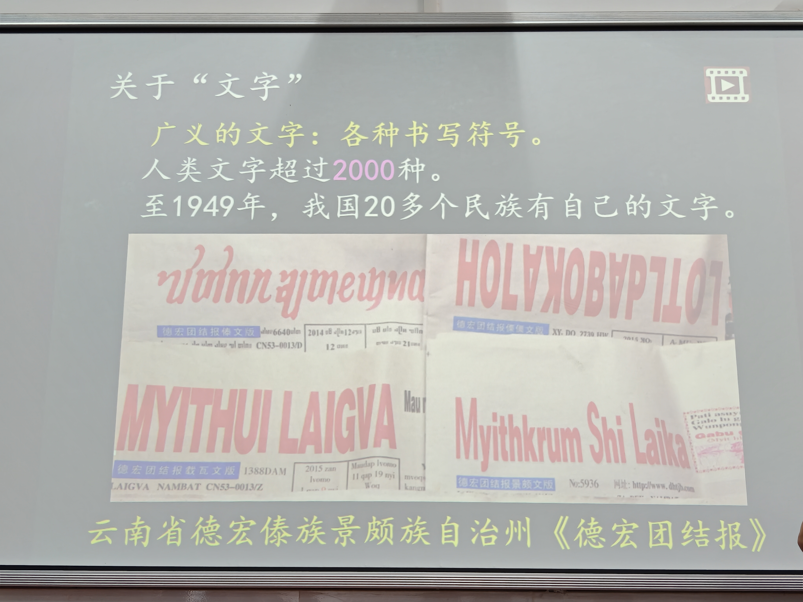 
### 区分“语言”和“文字”  
&emsp;&emsp;口语，是语音信号；文字是视觉符号。  
&emsp;&emsp;一种语言可以用不同的文字记录：  
&emsp;&emsp;例：敦煌藏经写本；八思巴蒙古文  
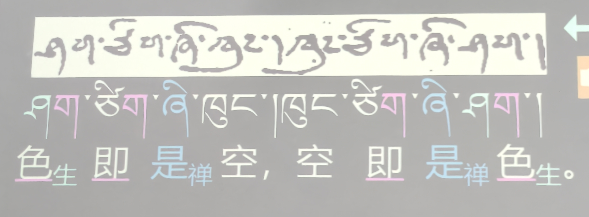  

### 区分“汉语”和“汉字” 
&emsp;&emsp;例：女书，小儿锦，注音字母，东干文（左宗棠收复新疆，曾被赶出，迁入，自称回族人。用基里尔字母拼写汉语。）  
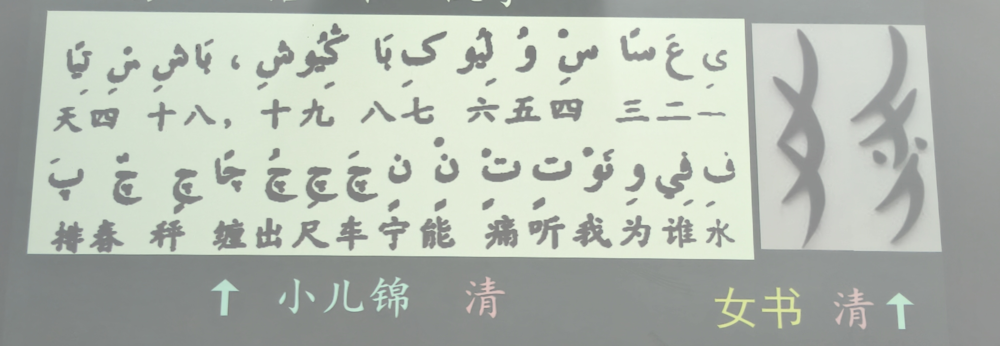  
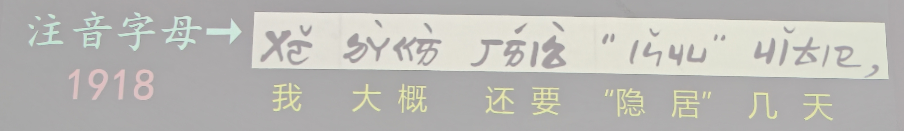
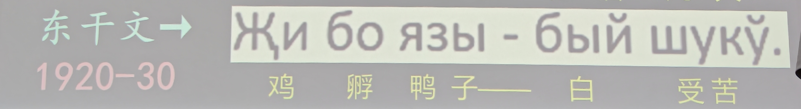 
### 除汉语外，汉字可记录不同的语言： 
&emsp;&emsp;哈利路亚（希伯来文，拉丁转写是Hallelujah。意思是：赞美你，耶和华。）  
&emsp;&emsp;南无阿弥陀佛（梵文，拉丁撰写是Namo Amitābha）  
&emsp;&emsp;俩一俩海，印兰拉乎（阿拉伯文，拉丁转写。意思是万物非主，唯有安拉）  
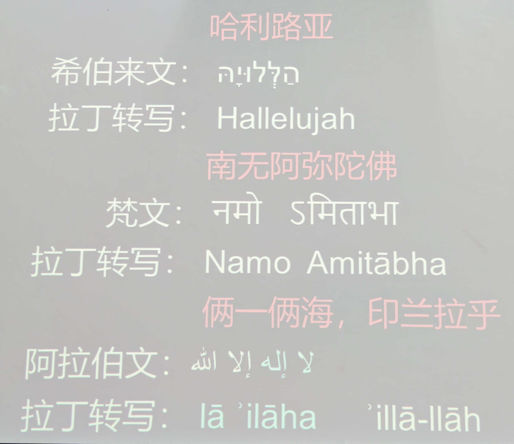"哈利路亚" 
### 汉字是自源文字 
&emsp;&emsp;从创制的来源上看，文字可分成两类：  
&emsp;&emsp;<u>借源文字</u>：创制时，借鉴或改造了其他民族的文字。（日语假名是借源文字，但不能说日文是借源文字，它有自源的部分）  
&emsp;&emsp;<u>自源文字</u>：本民族自创。**汉字属于自源文字。**  
&emsp;&emsp;**表意性**是汉字的重要特色，汉字具有**跨方言**、**跨时代**传播的优势，对中华文明的传承有着重要贡献。  
> &emsp;&emsp;“中国字是中国文化传承的标志。殷墟甲骨文距离现在3000多年，3000多年来，汉字结构没有变，这种传承是真正的文化基因。”  
> &emsp;&emsp;“要重视发展具有重要文化价值和传承意义的‘绝学’、冷门学科。这些学科看上去同现实距离较远，但养兵千日、用兵一时，需要时也要拿得出来、用得上。还有一些学科事关文化传承的问题，如甲骨文等古文字研究等，要重视这些学科，确保有人做、有传承。”——习近平同志谈汉字和汉字研究 

## 第二课 
### 汉字文化圈 
&emsp;&emsp;华人生活的地区和日本、琉球、越南、朝鲜、韩国等地都曾经或正在使用汉字，形成了“汉字文化圈”。  
&emsp;&emsp;汉字文化圈是中华文化对外传播的重要表现是古代中国综合国力的反映。汉字早在一千多年以前就是**国际性**的文字。  
**汉字文化圈内的语言分属于不同的语系**：  
&emsp;&emsp;汉语——汉藏语系；  
&emsp;&emsp;日语、朝鲜语——阿尔泰语系（争议中）；  
&emsp;&emsp;越南语——南亚语系；  
&emsp;&emsp;不能把汉字文化圈内的语言都视为汉语。  
&emsp;&emsp;日本、朝鲜、越南的书面语曾经长期用汉字记录汉语借词，并于另制方块形态的书写符号（假名、谚文、喃字等）混合使用。  
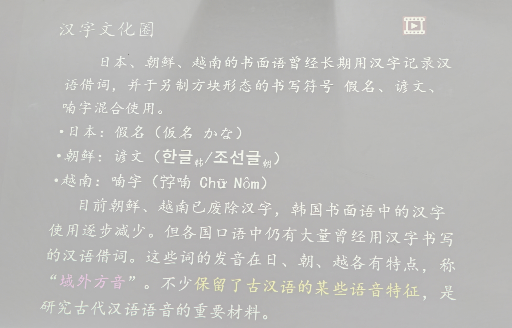  
&emsp;&emsp;目前朝鲜、越南已废除汉字，韩国书面语中的汉字使用逐步减少。但各国口语中仍有大量曾经用汉字书写的汉语借词。这些词的发音在日、朝、越各有特点，称“域外方音”。不少保留了古汉语的某些语音特征，是研究古代汉语语音的重要材料。  
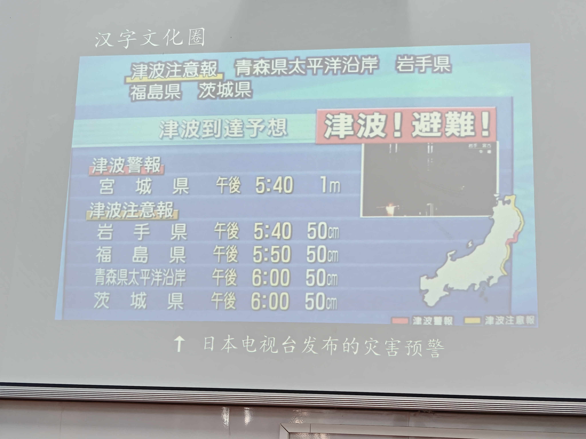  
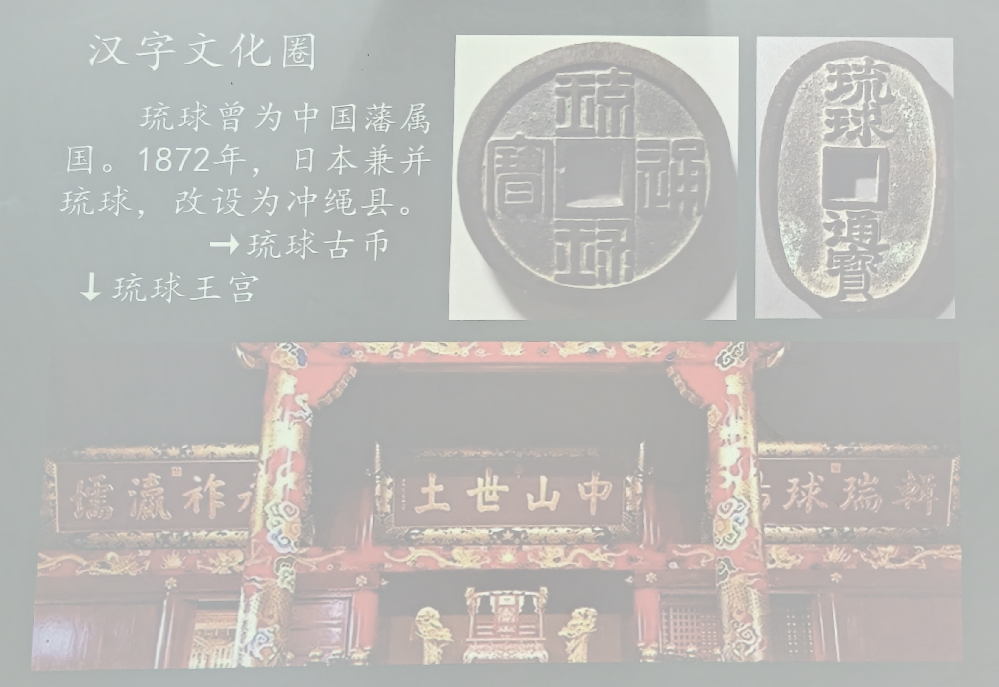  
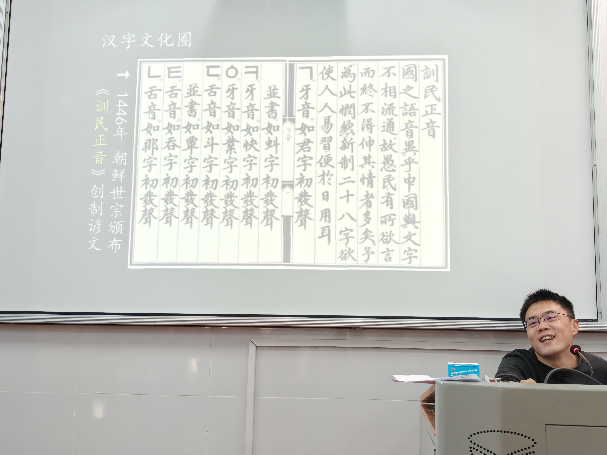  
 

<u>古埃及圣书字</u>  
<u>楔形文字</u>  
&emsp;&emsp;贝希斯敦铭文 伊朗 BC522  
&emsp;&emsp;用楔形文字记录了同意文章的埃兰语、古波斯语和巴比伦语三种版本。  
<u>玛雅文字</u>  

### 狭义的文字——汉字 
&emsp;&emsp;汉字是人类**正在使用**的，发展上**没有中断**的**最古老**的文字。  
&emsp;&emsp;“汉字”是后起概念，唐代以前称“文字”。秦刻石云“书同文字”，是称“文字”之始。  
&emsp;&emsp;“文”和“字”是并列关系。 
> &emsp;&emsp;黄帝之史仓颉，见鸟兽蹏(tí)迒(háng)之迹，知分理之可相别异也，初造书契。仓颉之初作书，盖依类`特征`象`模拟`形，故谓之文。其后形`本义是动词`声**相**`偏指代词，指向动作的一方，单向，句子成分中不一定出现，但语境中很清楚`益，即谓之字。文者，物象之本；字者，言孳乳而浸（渐）多也。——《说文解字叙》 

### “文”和“字”的意义考察 
文：甲骨文，像纹身人形。文→纹  
《说文》：“文，错画也。象交文。”  
《逍遥游》：“越人断发文身。”  

字：甲骨文无，系后起字。  
甲骨文，会双手于股间助产之意。  
《说文》：“字，乳也。”    
《论衡·气寿》：“妇人疏字者子活，数乳者子死。”  

&emsp;&emsp;《说文解字叙》：“依类象形，故谓之文，其后形声相益，即谓之字。文者，物象之本；字者，言孳乳而浸(渐)多也。  
文：“依类象形”，根据共性描摹事物形象。  
字：“形声相益”，用形容声音的方式造字。  
&emsp;&emsp;《说文》：“形，象形也。”王筠《说文句读》：“篆文形字，动字也。说解“象形也”之形字又是静字，谓象其形也。”  
&emsp;&emsp;字，与孳、滋、子、籽、崽同源，核心义素是【繁衍】。因此字可以表示“衍生”等义。e.g.名**字**、待**字**闺中 

### 从“小学”到“文字学” 
&emsp;&emsp;文字学，古人归为“小学”。  
&emsp;&emsp;《周礼·地官·保氏》：“保氏掌谏王恶， 而养国子以道，乃教之六艺:一曰五礼，二曰六乐，三曰五射，四曰五驭，五曰六书，六曰九数。”
《汉书·艺文志》:“古者八岁入小学，故《周官》保氏掌养国子，教之六书，谓象形、象事、象意、象声、转注、假借，造字之本也。”  
&emsp;&emsp;传统小学：文字、音韵、训诂。  
&emsp;&emsp;清末章太炎主张将传统文字学发展为专门的学术门类。  

**【文字学的门类】**  
&emsp;&emsp;文字学大体可以分为三个大的方面：  
1.古文字研究：研究小篆及其以前的文字  
&emsp;&emsp;材料：加固、青铜器、简帛、货币、石刻等等。  
2.近代汉字研究：研究隶书至清代文字  
&emsp;&emsp;材料：简帛、石刻、写卷、刻本等等。  
3.现代汉字研究：研究五四以来，记录现代汉语的汉字。  
&emsp;&emsp;材料：印刷本和数字化场景中的汉字。 

## 第三课 
### 汉字的定义 
&emsp;&emsp;“汉字是记录汉语的书面符号”这个说法由来已久。  
>&emsp;&emsp;口语是内心经验的符号，文字是口语的符号。——亚里士多德《工具论》  

>&emsp;&emsp;语言合文字是两种不同的系统。后者唯一存在的理由是在于表现前者。——（瑞士）索绪尔《普通语言学教程》  

&emsp;&emsp;但是以欧洲表音文字为文化背景的学术理论，并非放之四海而皆准。对此西方语言学家早有认识：

>&emsp;&emsp;我们的研究将只限于表音体系，特别是只限于今天使用的以希腊字母为原始型的体系。——（瑞士）索绪尔《普通语言学教程》  

**【对传统汉字定义的反思】**  
&emsp;&emsp;从发展的角度看，文字可以分为两个阶段:  
第一阶段：原始文字(proto-writing)  
第二阶段：成熟文字(full writing)  
&emsp;&emsp;周有光（1990）：世界各地在历史上创造过许多种原始文字，原始文字**都不能完备地按照词序记录语言**，有的只有零散的几个符号。有的是一幅无法分成符号单位的图画。有的只画出简单的概念，不能连接成句子。有的只写出实词不写出虚词，要读者自己去补充。  
&emsp;&emsp;若要求**记录语音**的才是文字，则文字产生就必须成熟，有成规模的组织系统**记录线性的句字语音和篇章**。这个标准对**原始文字**不适用。 

&emsp;&emsp;**早期零散符号是否记音无法证实，也无法证伪。**  
&emsp;&emsp;汉字和汉语的结合有一个过程。汉字的发展，一定有从原始到成熟的发展阶段。**当文献能验证汉字记录了汉语时，汉字无疑已经进入了成熟文字阶段。**  
&emsp;&emsp;先有文字，后有文献。  
&emsp;&emsp;文献产生前的原始汉字跟汉语**未必有严格对应关系，很可能**是零散字符表达交流内容的焦点信息，不完全记录线性声音信号。很难说“成熟的文字才是文字，不成熟的文字就不是文字”。 

&emsp;&emsp;汉字的发展，也可分为两个阶段：  
第一阶段：原始汉字(BC3500-BC1600)  
&emsp;&emsp;能粗略记录汉语，仍然沿用图画表达信息段 如《甲骨文合集》第10405片有如下文字：  
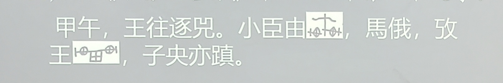  
第二阶段：成熟文字(BC1600-BC1046)  
&emsp;&emsp;已经能够完整地记录汉语音节、语素、词、短语、 句子等语言单位，除此之外，还可以表达语言之外的某些信息。 

&emsp;&emsp;即便是成熟阶段的汉字，还可以表达词、语素、音节等语言单位之外的信息:
1.《说文》：“哲，知也。从口，折聲……嚞，古文哲从三吉。” 嚞，后世多省作喆。  
2.《现代汉语词典》收录了下列词：  
&emsp;&emsp;米寿 白寿 茶寿  
3.1949年后，有下列变更：  
&emsp;&emsp;猺族→瑶族；犵狫族→仡佬族  
&emsp;&emsp;狪族→侗族；狇狫族→仫佬族  
&emsp;&emsp;獞族→僮族→壮族；𤠫𤢂族→傈僳族  
思考：是变词还是变字？ 

**【对汉字的客观定义】**  
种种事实表明：  
&emsp;&emsp;1.汉字和语言的结合有一个过程。  
&emsp;&emsp;2.汉宇除了记录语言，还能表达事物和观念。  
&emsp;&emsp;因此，汉字不是汉语的翻版，不是汉语的附庸形式，记录汉语并不是汉字存在的唯一理由。汉字的定义不宜削足适履，而应量体裁衣：  
&emsp;&emsp;<u>汉字是由其使用者共同创造的，不受时空限制而能表示一定事物和观念，并能记录汉语的平面视觉符号。</u> 

使用者：  
&emsp;&emsp;1.早期创制汉字的黄河流域华夏族  
&emsp;&emsp;2.后期融合民族，及认同华夏文化的诸多民族  
&emsp;&emsp;3.域外使用汉字的非华裔（朝、日、越等）  
传播特性：  
&emsp;&emsp;1.可存留于异时、异地（视觉符号的共性）  
&emsp;&emsp;2.受语音历时演变、方言差异干扰较小  
表示的对象：  
&emsp;&emsp;1.形体直接表示事物、观念  
&emsp;&emsp;2.记录汉语的词、语素、音节等语言单位</u> 

### 使用者对“字”的理解角度差异 
&emsp;&emsp;汉字的使用者，对“字”的理解，是多层次、多角度的。因此同样是说“字”这个词，它指向的概念可能不同。  
“谁敢说半个不字”“字正腔圆”  
“天空飘来五个字儿，那都不是事儿”  
“宋体字”“篆字” “柳字”  
“他的字写得真棒”  
“泪、淚是不同的字”  
“户字有户、户、戶三个写法”  
“岳、 嶽是一个字的不同写法” 

### 字样、字位、字种 
一、字样：文本载体中每一个具有记录功能的自然书写单位  
&emsp;&emsp;只要自然书写不同，就都是不同字样。或者楷体、宋体、黑体这种字体差异。或者书写风格差异，都属于不同字样。同一个字的不同繁简/异体形态，也都是不同字样。  
二、字位：**构型属性**相同的字样  
&emsp;&emsp;只要同一字的构型属性相同，就属于同一字位。如户的三种写法，上方是点、斜、横，但都是同一字位。如“够”字，左右部件可以互换位置`这叫异写字`，但构形属性相同，也是同一字位。“以”字，从古至今的不同写法，9个字样，对应2个字位（一个是有人形的，一个是去除人形的）；下图中的“国”，是、1个字种、3个字位（从囗从玉、从囗从无点的玉、从囗从或）。  
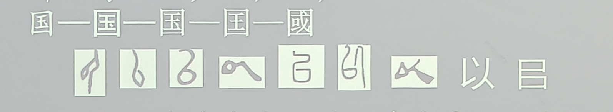
三、字种：构形所指向的**表达功能都相同**的字位  
&emsp;&emsp;例：泪——淚 是1个字种、2个字位、2个字样 

### 汉字的要素 
&emsp;&emsp;传统观点认为，汉宇必备要素是形、音、义，缺一不可，在解释汉字的过程中，要“形音义互求”
>凡文字有义有形有音……合三者以完一篆。——[清]段玉裁

&emsp;&emsp;形，是汉字必备的，但是音、义未必。  
有的汉字表意，但不表义：  
&emsp;&emsp;嘧啶=pyrimidine  
有的汉字不表音:  
&emsp;&emsp;原始汉字中的图形字、族徽；  
&emsp;&emsp;表达约定信息的训读字、代号字；  
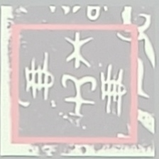  
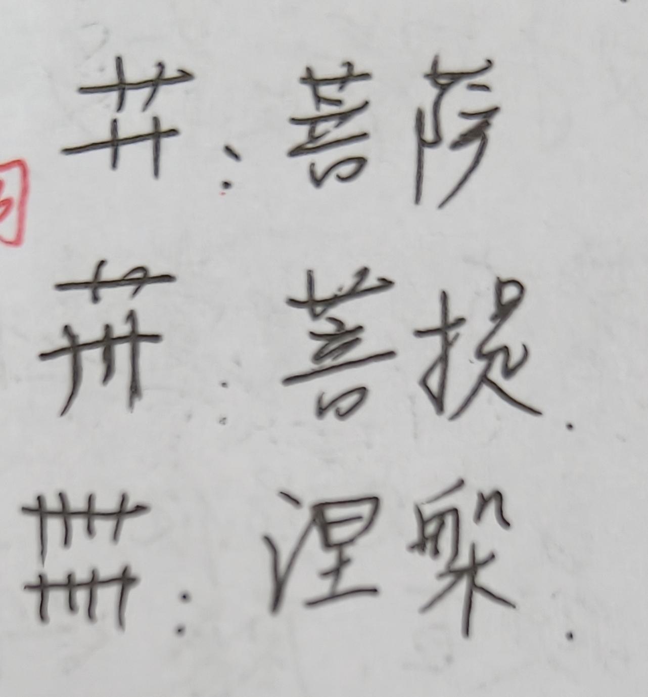
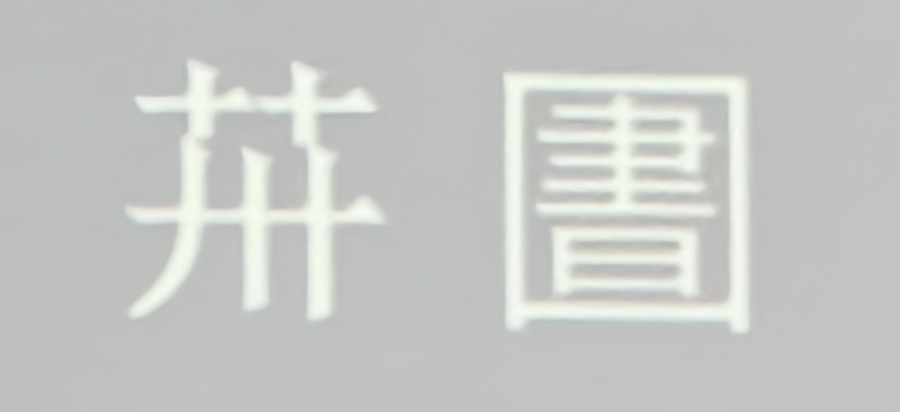 

### 考古发现看汉字起源 
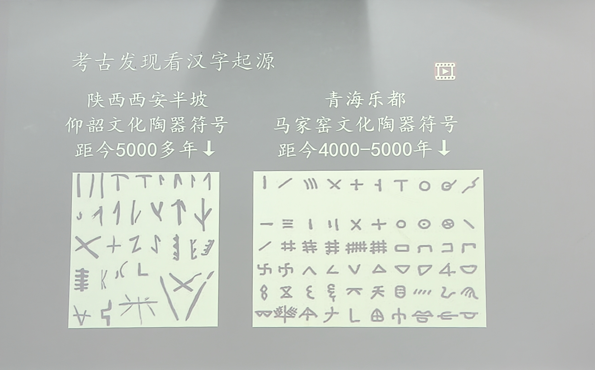  
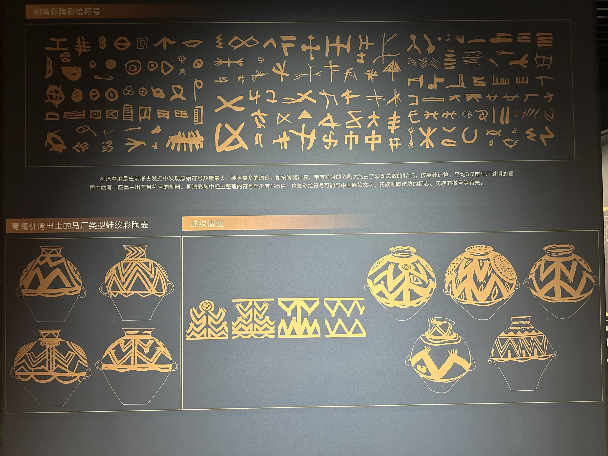  
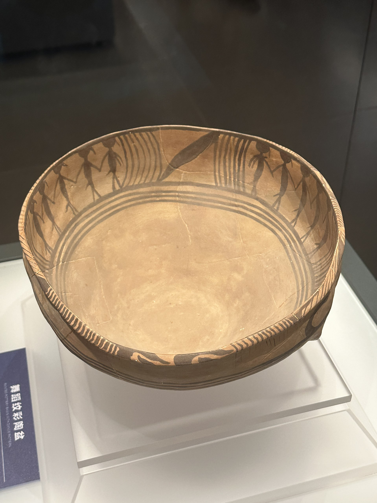  
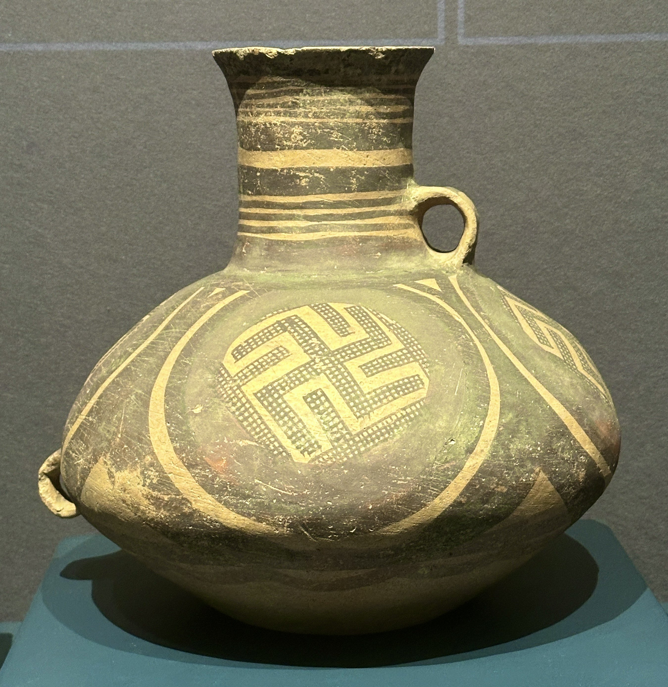  
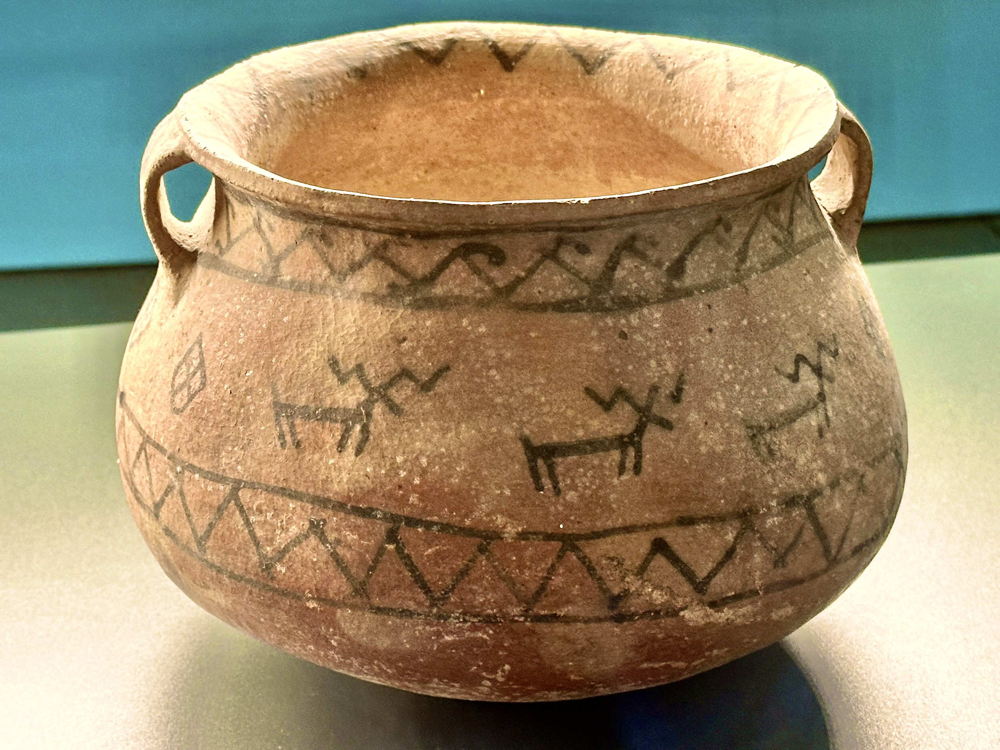  
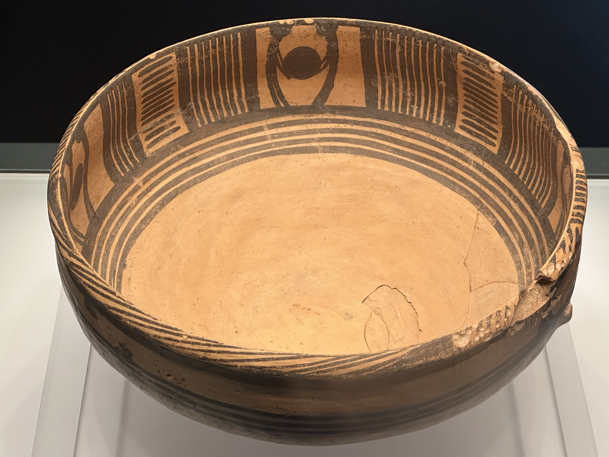  
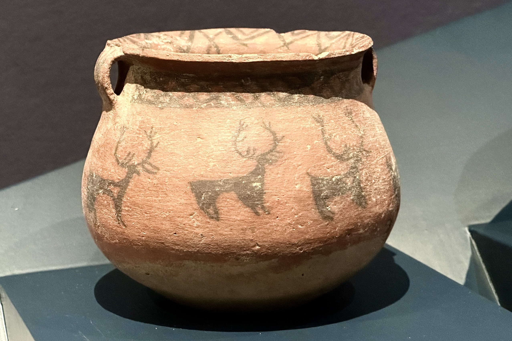  
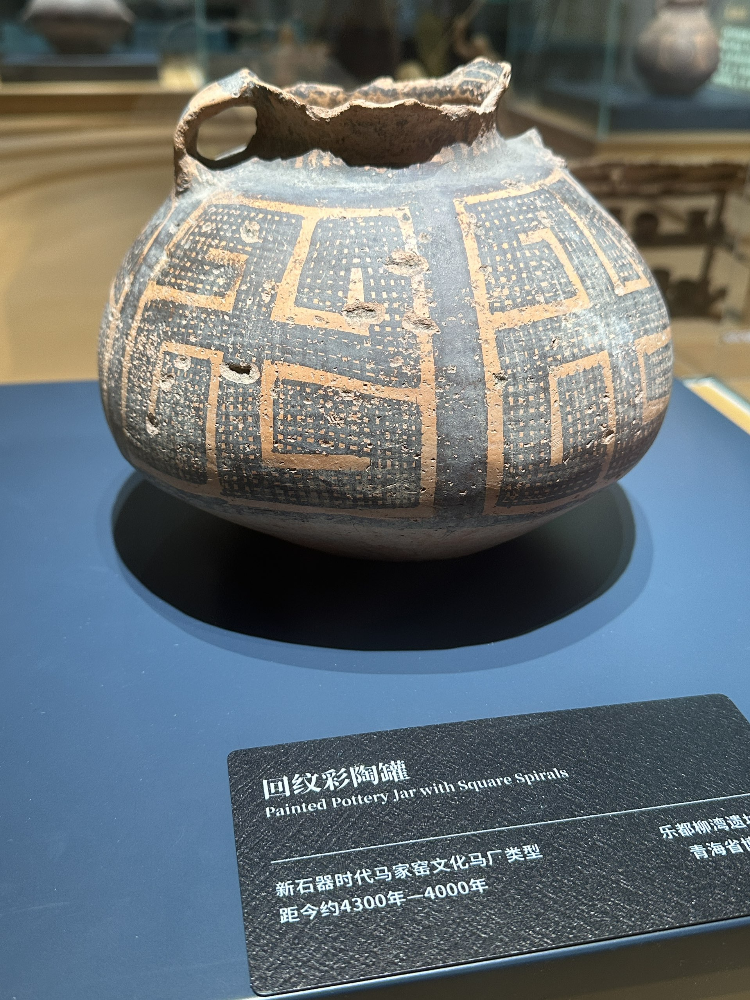  

>&emsp;&emsp;《尚书·多士》：“惟尔知，惟殷先人，有册有典，殷革夏命。”  

&emsp;&emsp;既然有了文献典册，那么可以说夏代的文字已经成熟了，只是考古还没有发现多少夏代的实物文献而已。  
&emsp;&emsp;如果不承认贾湖、仰韶、丁公村的这些符号是汉字的话`一般认为是“前文字”`，至少可以说，成熟的汉字源头，距今也有**4000多年**。  
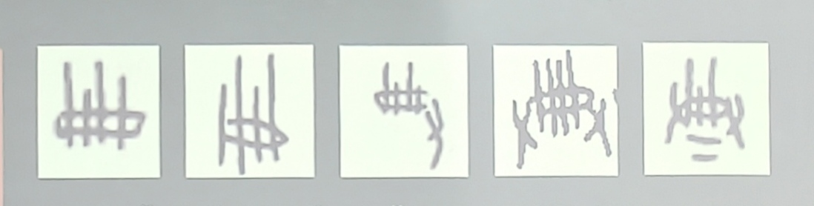 

&emsp;&emsp;甲骨文是目前发现最早的，无争议的汉字文献。最初由清代学者**王懿荣**从市面贩售的药材“龙骨”上发现。  
&emsp;&emsp;经考证，有字甲骨出土于河南安阳小屯村的殷墟遗址。 

### 甲骨文发现和解读的背景 
&emsp;&emsp;甲骨文是商代和西周的人可在用于龟甲和兽骨（包括人骨）上的文字，主要用于占卜记录。  
&emsp;&emsp;汉字从起源时代到今天一脉相承，发展没有中断。  
&emsp;&emsp;甲骨文发现较晚，不等于中国的文字学研究起步也晚。至少在汉代，出土文献和古文字的研究和释读已经展开。  
>&emsp;&emsp;鲁恭王坏孔子宅，而得《礼记》《尚书》《春秋》《论语》《孝经》。又北平侯张仓献《春秋左氏传》。郡国亦往往於山川得鼎彝，其铭即前代之古文。皆自相似。虽叵复见远流，其详可得略说也。——[汉]许慎《说文解字叙》
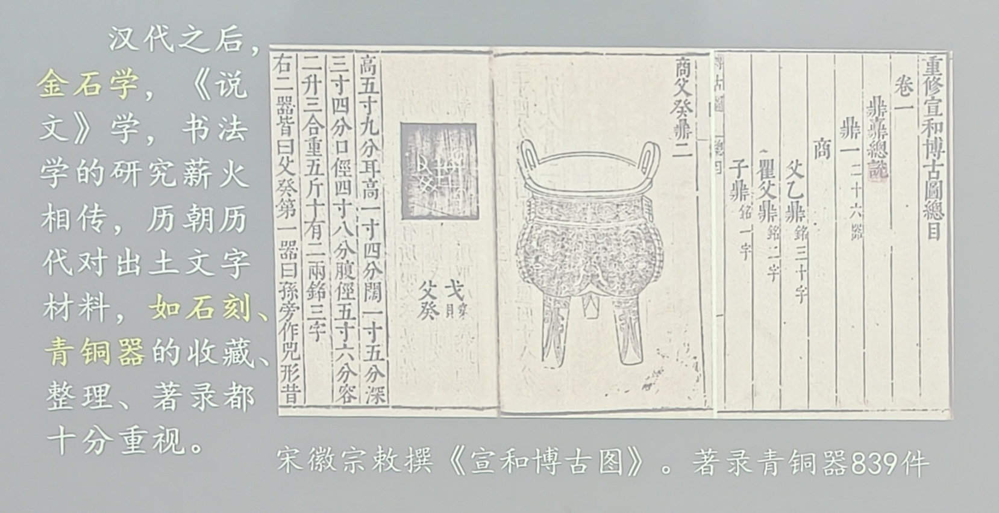  

