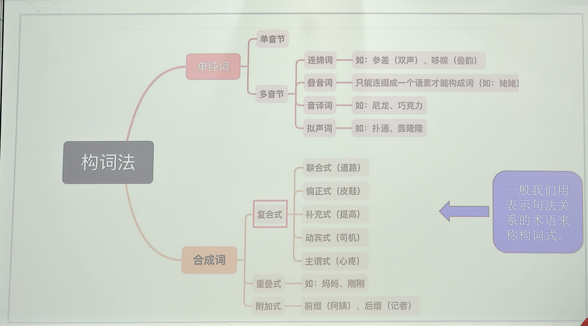
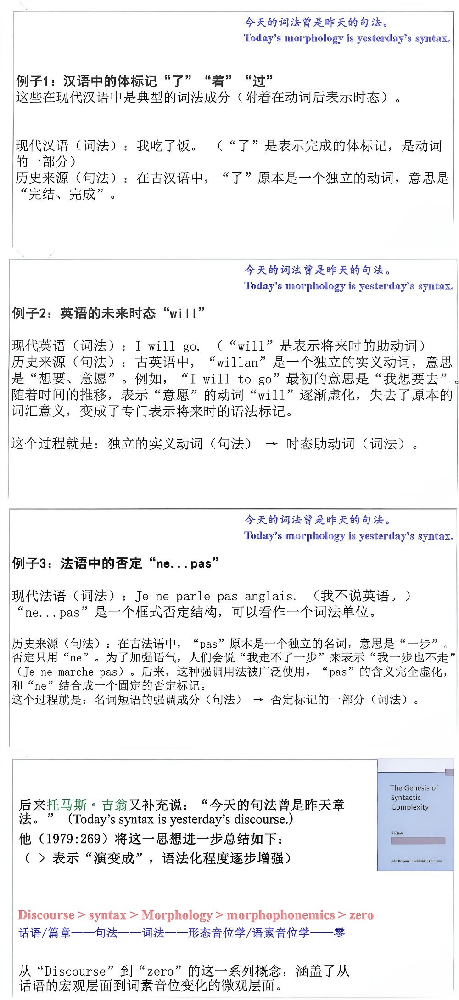
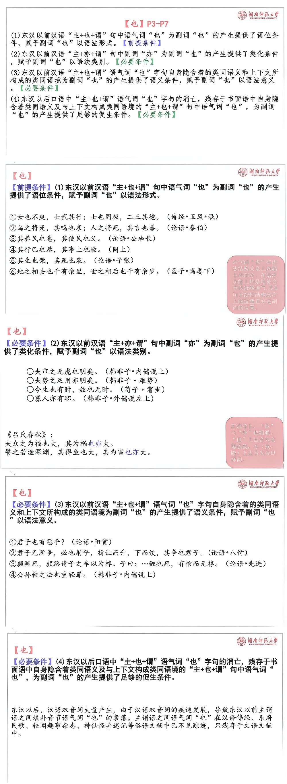
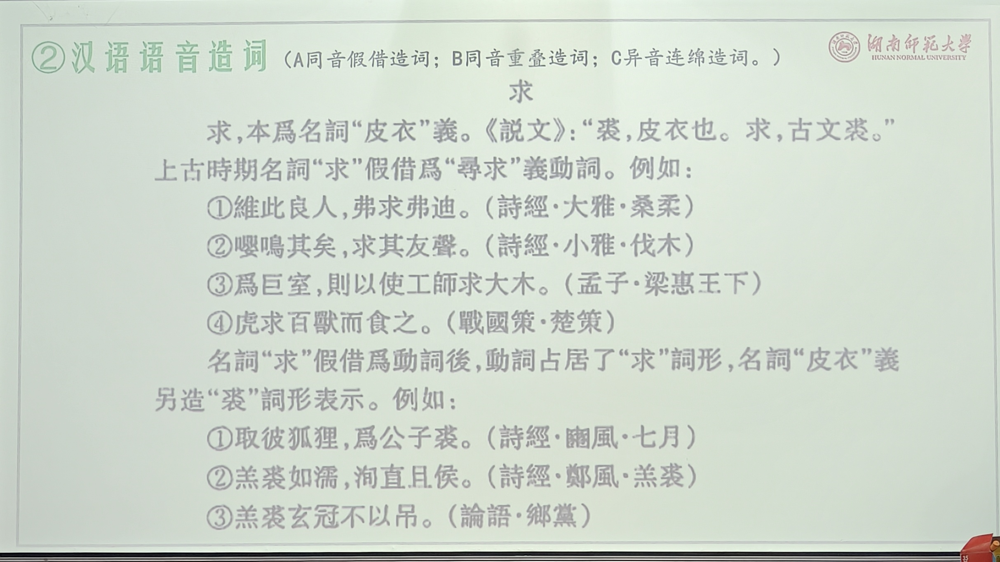
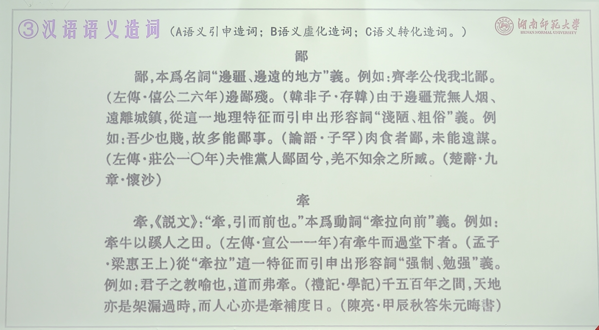

# 《词汇学》课程笔记 
## 绪论 词汇学略述——训诂学、词汇学、语义学(10.9) 
语言结构要素——语音、词汇和语法  
&emsp;&emsp;⚪语音：语言的物质外壳，是语言的表现形式  
&emsp;&emsp;⚪词汇：语义的载体，是语言的内容  
&emsp;&emsp;⚪语法：语言的内在“骨架”，是语言的结构规则  

### 语言学及“词汇学”的分出 
**（一）语文学时期**  
&emsp;&emsp;传统小学（古代汉语）：文字（字形）、音韵（语音）、训诂（语义、语法）  
【传统训诂学的成就】  
&emsp;&emsp;（1）对词的本义和引申义的研究；  
&emsp;&emsp;（2）关于同义的辨析；  
&emsp;&emsp;（3）对于音义关系的探求；  
&emsp;&emsp;（4）关于虚词的研究；  
&emsp;&emsp;（5）关于方言词汇的研究；  
&emsp;&emsp;（6）关于连绵词（联绵字）的研究；  
&emsp;&emsp;（7）对反训现象的发现；  
&emsp;&emsp;（8）古音通假与“因声求义”的揭示；  
&emsp;&emsp;（9）名物训诂的考证与辞例（句读）的归纳。  
&emsp;&emsp;`6-9，是清代小学的重要成就，是最能体现其超越汉唐人之处` 
【传统训诂学的不足】  
&emsp;&emsp;（1）没有摆脱经学附庸的地位；  
&emsp;&emsp;（2）把古汉语词汇当成平面来研究；  
&emsp;&emsp;（3）长时间没有摆脱文字形体的束缚；  
&emsp;&emsp;`“形训”“据形说义”本是科学的方法，但若依据的“形”本身是已经讹变的、后起的形体，结论必然出错。东汉许慎《说文解字叙》斥责当时根据字形随意解释汉字的乱象:“故诡更正文，乡壁虚造不可知之书变乱常行，以耀于世。乃猥曰：马头人为「长」，人持十为「斗」，「虫」者屈中也。廷尉说律，至以字断法，「苛人受钱」，「苛」之字止句也。”`  
&emsp;&emsp;（4）理论研究不够准确和深入；  
&emsp;&emsp;（5）缺乏对常用词的研究。 

**（二）现代语言学（结构主义）** 
&emsp;&emsp;到了20世纪初,以布龙菲尔德为代表的结构主语音形态语法义语言学兴起，语言学才真正成为一门独立的现代科学。其核心思想是**将语言看作一个自足的结构系统**。  
&emsp;&emsp;语音·音位学（音位）、形态·形态学（语素）、语法·句法学（直接成分分析）  
【**消失的词汇学**】  
1.索绪尔对“词”持保留态度  
&emsp;&emsp;《普通语言学教程》里索绪尔专门讨论过“语言单位是什么”，他的结论恰恰是：不能想当然地把“词”当作语言的基本单位。能指和所指的对应关系使“词”的边界很不确定一一不同语言切分同一条语流的方式完全不同（法语、德语分词不一样，汉语连“词”和“字”都纠缠不清）。所以结构主义的真正单位是“符号”组成的关系网络，词只是一个显眼但不纯粹的过渡现象。 

2.布龙菲尔德时期，词被“降格”，词汇被“除名”  
&emsp;&emsp;美国结构主义给词下过一个经典定义——“词是最小的自由形式”(minimum free form),但这个定义是消极的，分析的真正主角是语素：语素才是分布分析的基本单位，词只是“语素组合成的成品”。至于整个词汇(lexicon)，布龙菲尔德有句名言：“词汇表实际上是语法的附录，一份基本不规则现象的清单。" (The lexicon is really an appendix of the grammar, a list of basic irregularities.)  
3.“词汇学”在哪里  
⚪词汇研究/词汇学：  
&emsp;&emsp;①词典编纂(lexicography)：作为一种实用技艺继续存在（编词典），但没有理论地位，与语言学理论基本不相往来。  
&emsp;&emsp;②欧洲的语义场传统：特里尔(Triéer)1930年代的语义场理论，把词汇研究“词与词之间的意义关系”当作结构来处理，这实际上是“把词汇当系统研究”的第一次尝试。  
&emsp;&emsp;③苏联语言学传统：谢尔巴(山ep6a)的名言“词是语言的建筑材料”，加上“基本词汇”理论、斯米尔尼茨基等人的词汇研究，在苏联体系里词汇学是一门正牌分支学科。  

**（三）语义学(semantics)** 
⚪语义学的诞生:  
&emsp;&emsp;法国米歇尔·布雷阿尔(Michel Bréal)于1893年首次使用“语义学”(sémantique,英语semantics) ，1897年出版了《语义学探索》，这部著作被视为语义学的奠基之作，标志着语义学从词义研究中独立出来，成为一门新的语言学分支学科。（早在1825年，德国学者莱西希（K.Reisig）就提出了建立一门研究词义及其演变历史的学科，并将其命名为Semasiologie义符学或语义学，但没有得到重视和发展）  
【**语义学的特点**】  
&emsp;&emsp;（1）研究多种语言，容易得到一般性结论。（一般性）  
&emsp;&emsp;（2）强调对某一特定时间点上的语言系统进行共时研究。（共时性）  
&emsp;&emsp;（3）把词汇和词义作为一个系统来研究。（系统性）  
&emsp;&emsp;（4）词义基础上提出“义位”“义素”“语义场”等概念。（词汇场理论）  

**（四）词汇学(lexicology)** 
【**创立前**】  
&emsp;&emsp;词汇学并非自古独立，传统训诂、词典编纂和词源研究只是它的前史。  
⚪19世纪历史比较语言学虽推动词源和词义演变研究，但词汇仍附属于语音、语法和词典工作。  
⚪20世纪初，索绪尔式结构主义确立语言是共时符号系统，词义和价值由组合、聚合关系决定，这使词汇有可能被作为系统来描写。  
⚪20世纪中叶,尤其苏联、东欧语言学明确把词汇学与语音学、语法学并列，研究词的结构、构词、词义、词汇系统、词源和词典编纂，词汇学由此成为独立分支。中国语言学概论体系治用此路立。  
⚪英美传统则常不单列词汇学，而将其分散于形态学、语义学和词典学。  
&emsp;&emsp;总之，词汇学的诞生是现代语言学系统观下传统词汇研究逐步学科化的结果。  
【**创立后**】  
&emsp;&emsp;词汇学创立后，学者们开始重视词的构造、构成及规范，例如：  
&emsp;&emsp;<u>描写词汇学</u>:研究特定时期的词汇系统（如上古汉语词汇、中古英语词汇）。  
&emsp;&emsp;<u>历史词汇学</u>:追溯词汇的起源与发展（如英语中的法语词汇、汉语常用词的演变）。  
&emsp;&emsp;<u>普通词汇学</u>：研究语言词汇的一般理论，包括比较语言学方法。  
&emsp;&emsp;受生成语法影响，现代词汇学力求通过符号和公式提高理论的精密性与可验证性。20世纪70年代后，认知语言学派兴起，开始探索词义演变的认知机制（如隐喻、转喻）。  
【研究范围】  
&emsp;&emsp;传统词汇学的研究范围，主要包括:形态学、构词法、词源学、词义演变等。  
&emsp;&emsp;在词的语义问题上，传统词汇学研究中主要侧重考察单个词的语义演进路径和发展变化，即“以结构为取向的词汇语义研究方法”是该时期的主要特征。简言之，传统词汇学研究主要包括形态学、构词法和词源学，并主要采取以结构为取向的词汇语义研究方法。现代词汇学研究则侧重词汇系统的研究，尤其注重词汇语义系统的研究。  

**（五）词汇语义学** 
&emsp;&emsp;词汇语义学是语义学中研究词义的分支，它与词汇学在“词的意义”问题上高度交叉；它运用关系模型、成分分析、语义场、义素分析等语义学工具，研究词义结构、词义关系、多义、词义演变等问题，但不涵盖词汇学的全部内容。  
&emsp;&emsp;学科定位上，词汇语义学是语义学框架下的分支学科。词汇语义学以词汇意义为核心研究对象，属于语义学在词汇层面的具体应用。即“词汇语义学是传统语义学的发展，是现代语义学的分支”（张志毅、张庆云，2012:9）词汇学与词汇语义学均以词汇为研究对象，但词汇学更关注词汇的“形式-意义”整体（如词的构成、词性、搭配），而词汇语义学聚焦词义的“内部结构”及词与词之间的语义联系。  
&emsp;&emsp;现代词汇学通过语义学实现从结构到用法（语用）为取向的词汇语义学研究的转变。这种跨学科融合使词汇语义学既能深入词汇内部结构，又能解释语义与认知、社会的互动关系。  
`《词汇语义学理论》`  
&emsp;&emsp;`比利时鲁汶大学 Dirk Geeraerts（德尔克·吉拉兹）的《词汇语义学理论》(Theories of Lexical Semantics)（2010）是一部具有里程碑式意义的词汇语义学专著。该书对19世纪以来词汇语义学研究的传统、沿革和现状进行了全面系统的梳理，从历时视角呈现了词汇语义学研究的五个理论框架: `   
&emsp;&emsp;`①历史语文语义学(historical-philological semantics);②结构主义语义学(structuralist semantics);③生成语义学(generative semantics);④新结构主义语义学(neostructuralist semantic);⑤认知语义学(cognitive semantics)`  

【**词汇语义学研究理论框架**】  

1.**历史语文语义学**：这是词汇语义学最古老的渊源，属于前结构主义时期。  
&emsp;&emsp;研究重点：单个词语的历史起源和意义演变。  
&emsp;&emsp;方法理论：词源学考证、历史文献分析。主要工作是追溯一个词从古至今的意义发展链条，并对其进行分类（如词义的扩大、缩小、转移）。  
&emsp;&emsp;特点：孤立地研究每个词的历史，缺乏系统性的视角。它更接近于“训诂学”或“词源学”，为后来的研究积累了丰富的材料，但本身并非现代意义上的理论框架。  

2.**结构主义语义学**：这是词汇语义学作为一门现代学科真正诞生的标志。  
&emsp;&emsp;研究重点：词汇作为一个系统的内部结构关系。强调词义不是独立的，而是由它在一个语言系统中所处的位置（与其他词的关系）来定义的。  
&emsp;&emsp;方法理论：①语义场理论：将词汇划分为有结构的语义场（如颜色场、亲属场），场内的词相互定义。②关系型分析：重点分析词与词之间的聚合关系，如同义关系、反义关系、上下义关系、部分整体关系等。③成分分析：将词义分解为一组更小的语义特征（如“男人”=[+人类][+男性][+成年]）。  
&emsp;&emsp;特点：系统性的、共时性的、关系性的。它试图用一套精确的模型来静态地描述词汇系统。  

3.**生成语义学**：20世纪60年代前后，生成语义学试图将词汇语义学形式化，并纳入更宏大的语法理论中。    
&emsp;&emsp;研究重点：词义在句子层面的组合性以及其逻辑表达。  
&emsp;&emsp;方法理论：①生成语义学:认为句法生成源于语义表达，词汇是句法转换的结果。它关注词义如何分解成语义基元，并如何与句法结构互动。②逻辑语义学:运用数理逻辑的工具（如谓词逻辑、入-演算）来精确地刻画词义和句义，重点关注真值条件和题元角色。  
&emsp;&emsp;特点：形式化的、组合性的、与句法紧密接口的。它追求语义表达的精确性和可计算性。  
>  即如何用规则从结构A转换成句子B。  

4.**新结构主义语义学**：这是在批评经典结构主义过于僵化的基础上发展起来的，试图让结构主义模型变得更灵活、更具解释力。  
&emsp;&emsp;研究重点：解决经典结构主义无法很好处理的模糊性问题，如一词多义、语义模糊、范畴边界不清等。  
&emsp;&emsp;方法理论：①原型理论：认为词义范畴不是由充分必要条件定义的，而是由最佳范例（原型）和家族相似性结构组织起来的。②词汇网络模型：将一个多义词的各个义项看作一个相互联系的网络，研究义项之间如何通过隐喻、转喻等机制连接。  
&emsp;&emsp;特点：灵活的、基于认知的（是通向认知语义学的桥梁）、 描述更符合语言事实的。  
&emsp;&emsp;比较：早期结构主义语义学建立了“词义是一个系统”的观念， 新结构主义语义学则试图把这个系统用更形式化、更接近逻辑和计算的方式表达出来。  

5.**认知语义学**：这是Geeraerts（德尔克·吉拉兹）本人所致力于的范式，也是当前词汇语义学研究的主流之一。  
&emsp;&emsp;研究重点：将词汇语义与人类的整体认知能力（如感知、范畴化、隐喻、转喻、意象图式、百科知识）联系起来。  
&emsp;&emsp;主要观点：①意义就是概念化:词义不是客观世界的镜像，而是人类对世界进行主观概念化的结果。②百科观：词义与我们的百科知识无法分割，没有明确的“语言意义”和“外部知识”的界限。 隐喻和转喻是核心认知机制：它们不仅是修辞手段，更是思维和词义扩展的根本方式。  
&emsp;&emsp;特点：体验性的、以人为本的、解释性的、动态的。  

  

### 汉语词汇学 
**（一）汉语词汇学的创立** 
&emsp;&emsp;汉语词汇研究从语法学中脱离发展成为独立的学科是在20世纪50年代之后。1955年，“现代汉语规范问题学术会议”的召开，为汉语词汇研究发展成为一门独立学科提供了良好的契机。  
&emsp;&emsp;孙常叙《汉语词汇》（1956年）的出版标志着汉语词汇学的正式创立。  
【**开山之作**】  
&emsp;&emsp;《汉语词汇》是汉语词汇学的开山之作，也是孙常叙先生最主要的著作。该书以现代汉语实词为主要研究对象，从理论和实际就“词”词汇和基本词汇”以及“词汇音变”三方面别地试论了汉语词汇的一些主要问题和一般规律。全书近500页。  
&emsp;&emsp;`孙常叙(1908-1994)，字晓野，吉林人，主要研究古文字、词汇学和楚辞。主要论著有:《汉语词汇》《龟甲兽骨文字集联》《孙常叙古文字学论集》等。`  
【**理论基石**】  
&emsp;&emsp;周祖谟《汉语词汇讲话》1955-1957年间通过连载文章普及词汇学知识，在汉语界较早提出“词汇学”术语。  
&emsp;&emsp;此书虽然晚出，但它在理论框架、教学影响和学科规范上影响更大，所以称“理论基石”强调它为后来的汉语词汇学确立了基本框架和研究范式。  
&emsp;&emsp;在理论框架上，为汉语词汇研究建立了一个清晰、系统的理论框架。如书中将“词义”作为独立的一讲，并定义为“人们在社会生活实践的过程中确定下来的含义”，这为后来关于词义与概念关系的深入讨论奠定了基础。  
&emsp;&emsp;在学科规范上，书中专门设有“汉语词汇规范化问题”一讲，探讨词汇规范化的必要性与原则。这体现了作者从社会功能派立场出发，旨在提高社会成员正确使用词语的水平。  
  
  
**（二）汉语词汇学的研究对象** 
&emsp;&emsp;研究对象：词和词汇  
&emsp;&emsp;范围划分：古代汉语词汇学（两种形态：传统小学+现代视角）现代汉语词汇学（现代汉语语法部分中的词法学）  
&emsp;&emsp;研究内容：词的语音特点、词义特点，词的演变、词义及词义的引申
变化还要研究词与词之间的关系，如同义、反义关系，同源关系；还要研究文字与词汇的关系。  
&emsp;&emsp;⚪传统词汇学：按学术传统与方法命名：指传统小学（语文学）系统中的词汇研究，本质上就是训诂学里处理词的那部分。它的研究对象恰好是古代汉语词汇，但特点是：为解经服务、把词汇当平面处理、重疑难词轻常用词。  
&emsp;&emsp;⚪古代汉语词汇学：按研究对象命名:研究对象是古代汉语的词汇:词的构成、词义、同义反义关系等。它只规定“研究什么” ，不规定“怎么研究”。所以它可以有两种形态：①传统的：如清儒的训诂考释；②现代的:用现代语言学方法系统描写古代汉语词汇,如赵克勤《古代汉语词汇学》。  
&emsp;&emsp;⚪汉语历史词汇学：按研究视角命名:是现代语言学意义上的学科，以历时视角研究汉语词汇从上古到近代的演变，用现代语义学理论（语义场、概念场、认知语言学等）分析问题，还包括常用词更替、词汇化、词典编纂、语料建设等。  

### 汉语历史词汇学 
**（一）基本介绍** 
  
**（二）基本内容** 
&emsp;&emsp;对王力《汉语词汇史》、史存直《汉语史纲要》、潘允中《汉语词汇史概要》、汪维辉《汉语词汇史》等10来种汉语历史词汇学专著总结后可以简单了解到，汉语历史词汇学的研究内容大致可以归纳为以下11个方面:  
&emsp;&emsp;（1）基本词汇；（2）同源词和滋生词；（3）同义词和反义词；（4）成语、谚语和典故；（5）借词和译词；（6）意义和词的关系；（7）词义的演变；（8）构词法；（9）词汇和语音、语法的关系；（10）社会发展和词汇发展的关系；（11）汉语词汇对周边语言的影响。  

### 词汇学研究的不足、展望与未来趋势 
  
  
  
   
  
  

### 词汇学学者、书目推荐及新观念 
  
  
  
  
  
  
  

## 第一讲 古汉语中的字和词(10.16) 
### 1.1字、词、语素
**1.1.1语言的层级体系**  
&emsp;&emsp;音位→语素（①构词材料）→词（②造句材料）→句子（③语言交际单位）  
&emsp;&emsp;词是词汇研究的基本单位，不仅是词汇的基本单位，而且是作为整体的语言的基本单位（包含语言一般的本质特征）  
&emsp;&emsp;语素是词的构成元素，是最小的有意义的语言单位，在西方语言学里，词汇学的最小单位是语速。  

**1.1.2字与词的关系**  
&emsp;&emsp;汉语中的字与词的关系，一直是个纠缠不清的问题。大致是介于语素和词之间的尴尬位置。  
&emsp;&emsp;⚪古汉语中的“词（辞）”出现得很早，一般不是我们今天说的词，而是专指助词（虚词）  
&emsp;&emsp;⚪古汉语中的“字”，多等于我们今天说的词。古人认为“字”主要意义有两个：①表示文字，即记录语言的符号的文字(character)；②将“字”作为表示汉语的语言单位，即“词”(word)；
>“圣人之制字，有义而后有音，有音而后有形。学者之考字，因形以得其音，因音以得其义。”  
>又：“小学有形、有音、有义，三者互相求，举一可得其二。有古形，有今形，有古音，有今音，有古义，有今义，六者互相求，举一可得其五。——段玉裁《广雅疏证序》 

### 1.2汉语的基本结构单位 
**1.2.1学界的观点**  
&emsp;&emsp;①有的学者认为“词”是印欧系语言的一种基本结构单位，而不是汉语的基本结构单位。  
&emsp;&emsp;②有的学者提出汉语是“字本位”语言。  

**1.2.2字本位理论——徐通锵**  
&emsp;&emsp;关于“‘字本位’理论” ，阐述得最充分、影响最大的学者是徐通锵先生。他的观点，在他的《汉语字本位语法导论》《语言论》中说得非常清楚。  
>《语言论——语文型语言的结构原理和制究》  
>徐通锵(1931-2006)，浙江宁海人。北京大学中文系教授，博士生导师。  

  

⚪徐通锵《汉语字本位语法导论》：  
&emsp;&emsp;“字是汉语的基本结构单位，它的特点是“1个字。1个音节。1个概念”的一一对应。  
&emsp;&emsp;“我们可以从语言学的角度将字定义为‘一个音节关联着一个概念的结构单位。”    
&emsp;&emsp;注意：这里所说的“字”首先是语言单位、听觉单位。当然，如果在书面上记录下来，则同时又是文字单位、书写单位。  

&emsp;&emsp;如果通常所说的“语素”，按“字本位理论”把它叫作“字”，那还仅仅是名称的不同。问题在于:这种单位究竟是不是汉语的基本结构单位？  
&emsp;&emsp;我们用《导论》所说的三条来衡量。  
&emsp;&emsp;第一，现成的， 拿来就能用。  
&emsp;&emsp;第二，离散的，封闭的，很容易与其它结构单位区分开来。  
&emsp;&emsp;第三，在语言社团中具有心理现实性。  

**1.2.3蒋绍愚**  
&emsp;&emsp;蒋绍愚(2015)把第一条改了一下：  
&emsp;&emsp;①能独立运用的，是某种语言里词库中的成员，是语法分析的基本单位【能独立运用】；  
&emsp;&emsp;②离散的，封闭的，很容易与其他结构单位区分开来；【现成的】；  
&emsp;&emsp;③在语言社团中具有心理现实性。  【社会心理的基本单位】
在英语等印欧系语言中，这三条是一致的。也就是说，①语言学的基本单位，是②现成的，就是③社会心理的基本单位：这就是英语的word。  

**1.2.4基本单位**  
**语言学的词**一一语言学的基本单位  
**社会学的字**一一社会心理的基本单位  
>&emsp;&emsp;“社会学上的字跟语言学上的词，彼此不同。不管咱们给造句学上的（词下的定义是怎么科学化，都改变不了一般中国老百姓对中国话里的小单位‘字的概念。比方有人要问‘现在’这个造句词(syntactic word)是什么意思，他会说： ““现在” ，这两个字是什么意思？’——赵元任  

&emsp;&emsp;<u>结论：“字”是中国人熟悉的社会心理单位，而汉语的基本结构单位是“词”而不是“字”。</u> 

### 1.3语素的讨论 
**1.3.1自由语素与黏着语素**  

&emsp;&emsp;语素根据构词能力可以分为：  
&emsp;&emsp;自由语素:不仅可以单独构成一个词，还可以和别的语素组合成词，组合时它的位置可前可后。【成词语素】【自由语素】  
&emsp;&emsp;半自由语素:不能单独构成一个词，但是可以和其他语素组合成词，组合时它的位置可前可后。【不成词语素】  
&emsp;&emsp;不自由语素:不但不能单独成词，而且在和其他语素组合时，它的位置是固定的。【不成词语素】【黏着语素】  

**1.3.2“半黏着”语素**  
&emsp;&emsp;有学者认为自由语素/成词语素与黏着语素/不成词语素 之间还应有一个语素：一般情况下黏着（词内成分），特定情况（满足一定的韵律条件）下自由。  
【案例】：趋。现代汉语中“趋”多用于复合词中，如“趋势”“趋利避害”。然而：  
&emsp;&emsp;e.g.随着悦里的增多，他的作品**更趋**完善。  
&emsp;&emsp;e.g.他最近情绪**趋于**稳定。  
&emsp;&emsp;⚪更+自由动词：更趋、更显得、更具有、更充满；
→趋：动词性“半黏着”语素。  
【案例】校。“校”前方加上指示性成分，就可以做主宾语。  
&emsp;&emsp;e.g.此校是他学习的地方。（主语）  
&emsp;&emsp;⚪此+病；→校：名词性“半黏着”语素。  

**1.3.3“半黏着”自由使用的方法**  
动词或形容词性“半黏着”语素：  
&emsp;&emsp;①前加副词（更觉、颇感、极佳）；  
&emsp;&emsp;②前加否定词（不予、不觉）；……  
名词性“半黏着”语素：  
&emsp;&emsp;①前加指示词（本刊、贵司、鄙校）；  
&emsp;&emsp;②后加方位词（校外、途中、院内）；……  
副词性“半黏着”语素：  
&emsp;&emsp;暗道、暗想；深知、深觉……  

**1.3.4“半黏着”语素的特征**  
&emsp;&emsp;性质上：句法自由；语音依附。韵律因素上，与“半黏着”语素结合的成分都是单音节的，二者合为双音节音步。
>汉语中一个标准的韵律词必须是双音节的。——冯胜利  

### [特]人类语言学的单位——token 
  

## 第二讲 构词法、造词法和词汇化 
&emsp;&emsp;汉语中词是怎样构成的？  
&emsp;&emsp;构词法、造词法、词汇化、语法化  

### 2.1基本概念 
①构词法  
&emsp;&emsp;基于世界上大部分语言的构词法， Schmid(2015)指出构词法最常见的分类方式为语素构词法和非语素构词法。英汉构词法基本符合这一分类方法。  
&emsp;&emsp;语素构词法:主要指两个或多个语素构成一个新词，如英语中的两个单词构成复合词、单词和词缀构成派生词等。如英语中的两个单词构成复合词、单词和词缀构成派生词等，因此语素构词法包括复合法(compounding)和派生法(Derivation)。  
&emsp;&emsp;非语素构词法:主要指构词成分并非都是语素，也可以是字母或某个单词的部分，这些组合构成一个新词。包括融合法(blending)、缩短法(clipping)、首字母缩略法(acronym-formation)和重叠法(reduplication)。  
>张志公《汉语语法常识》：“词的构成的规律叫作构词法。”

>高名凯《普通语言学》：“研究词的结构和词的构造方法的科学叫做构词法。”

>张寿康《构词法和构形法》： “作为一门科学，构词法就是研究咱们语言中词的构造规律的学问。”

&emsp;&emsp;构词法(Word-Structure)是词的内部结构形式及构成新词的方法。汉语构词法，一般分为两种类型：复合法和附加法。  

②造词法：一般指创造新词的方法，研究用什么素材和方法创造新词。从理论上讲，造词法不同于构词法，但造词法的不同往往决定了构词形式的不同，构词形式的不同又体现一定的造词的规律，所以不少著作把造词法等同于构词法。  
&emsp;&emsp;任学良《汉语造词法》将二者相区别，谓造词法“研究用什么材料和方法创造新词” ，构词法“研究词的内部结构形式”。  

③词汇化：短语或句法结构逐渐凝固成词的过程叫做词汇化。表现在汉语里就是复合词的不断产生和发展。（古代汉语知识辞典，2007）  
&emsp;&emsp;联合短语、偏正短语、动宾短语、动补短语、主谓短语、介宾短语以及某些超层次句法结构都可以词汇化为复合词。  

④语法化：  

### 2.2汉语构词法 
&emsp;&emsp;20世纪80年代,学者们逐渐发现汉语不仅在构字、构词上具有某种**一致性**，而且发现汉语的词、短语和句子在结构上的一致性。
>“词的解剖或许可以成为短语、句子解剖的显微和缩影。”（潘文国，2004:3）

>“只有第一步从构词法学起，才能切合汉语的语法研究因为明白了词与词组的结构，自然会明白造句法。”  （郭绍虞 1979:750）

  
  
  
  

“词式”术语的评价 
&emsp;&emsp;当前的主流术语是：“构词法”作为总称，其下分为“复合构词法”“派生构词法”等，再具体到“并列/联合结构”“偏正结构”等。  
&emsp;&emsp;刘叔新的术语是：“词式”作为总称，其下分为“复合词式”“附加词式”等，再具体到“并列式”“修饰式”等。  
&emsp;&emsp;最终，学界选择了前者而非后者作为通用的表述方式。  
&emsp;&emsp;但这并不意味着刘叔新的理论被否定，而是学术共同体在术语选择上的一种“自然选择”。他的思想精华已经融入了我们对汉语词汇的认识之中。  

### 2.3构词法和句法的关系 
&emsp;&emsp;词的结构和句法结构有没有关系？这有两种看法：  
&emsp;&emsp;一种认为复合词的构成成分间的关系和句法关系完全不同；（刘叔新《汉语描写词汇学》）  
&emsp;&emsp;一种认为复合词的构成成分间的关系和句法关系基本一致。（赵元任《中国话的文法》、陆志韦1957等）  

**2.3.1词法从句法来：词的结构和句法结构的密切联系** 
&emsp;&emsp;语法学家托马斯·吉翁(T.Givon，1971)有句名言：今天的词法曾是昨天的句法。  
>Today's morphology is yesterday's syntax.

&emsp;&emsp;意思是说，从历史发展的角度来看，句法和词法不是截然分开的，而是有密切的联系：很多在历史上是词组，而今天凝固成词，所以过去的句法成了今天的词法。  

&emsp;&emsp;词法(Morphology)：指的是词语内部的构成规则，包括派生和屈折。它关注的是语素如何构成词。  
&emsp;&emsp;句法(Syntax)：指的是词语之间的组合规则，即如何将独立的词组合成短语和句子。  
  
&emsp;&emsp;**Discourse > syntax> Morphology > morphophonemics>zero**  
&emsp;&emsp;**话语/篇章——句法——词法——形态音位学/语素音位学——零**  

&emsp;&emsp;Norde (2002)认为语法化的最后阶段可以是词汇化，即：  
&emsp;&emsp;话语构成>句法化（语法化）>词汇化>屈折词缀  
&emsp;&emsp;董秀芳（2003）在对“X着”的词汇化研究中也有类似看法。汉语中不少实词在语法化为虚词之后，又进一步变为词内的组成部分。如太田辰夫（1958）指出的“边”。  

&emsp;&emsp;原先作为语篇连接手段的and逐步演化为相对稳定的并列连词，后来有进一步语法化，用来表示多种隐含的主从关系，如and可用来表示条件、结果、让步等。例：  
&emsp;&emsp;He is lazy and his brother is diligent.他很懒，而他的弟弟很勤奋。  
&emsp;&emsp;She is very busy and she doesn't come home very often.她很忙，所以不常回家。  
&emsp;&emsp;Let's give him some help and he will be able to overcime the difficulties in his studies.只要咱们给他些帮助，他就能战胜学习中的困难。  
&emsp;&emsp;I'll go and get some water.我去拿些水来。  

又如：  
[1] I think that your mother will permit this.  
[2] I think ( ) your mother will permit this。  
[3] Your mother will permit this, I think.  
&emsp;&emsp;这三个例子也可从语篇层次作出解释它们从表面上（例3）词序发生了变化。和意义来看差别不是很大，但对于语法化研究确实意义很大。  
&emsp;&emsp;例[1]具有完整的句法构造，主要分句为I think后面由that引导出一个宾语分句。  
&emsp;&emsp;例[2]引导宾语分句的that省略了。使得表示宾语分句的简单化。这也是语法化现象。  
&emsp;&emsp;例[3]则将I think置于句后，弱化为附加成分。相当于副词的功能，表示maybe的意思。  

&emsp;&emsp;更重要的是，有些构词法，从今天的共时平面上也许难以找到基本一致的句法结构，但在历史上能够找到。例如：  
**句法结构“动词+原因”**  
·“卧病”。《现代汉语词典》：“卧病，因病躺下。”  
&emsp;&emsp;在现代汉语中，“卧床”“卧轨”以及“卧室”“卧龙”都有相应的句法结构，而“卧病”的句法结构很罕见。但古代有不少。  

**2.3.2从句法标签到多维互动：词的结构和句法结构的不同** 
&emsp;&emsp;吉翁的名言说的是“词法曾是句法”，而不是“词法就是句法”。一旦一个形式已经凝固为词，它就不再服从句法的操作规则。也就是说：**历史上又来源关系，不等于共时上有相同的结构属性。**  

**①词汇完整性假说(LIH)**  
&emsp;&emsp;词的结构和句法结构毕竟是两个层面的东西，说一些词的结构和句法结构“基本上一致”，是说它们的构成原则一致，但词的结构比句法结构要紧密得多。  
&emsp;&emsp;词汇学上有个“词汇完整性”原则(Lexical Integrity Hypothesis)，这个原则指的是：短语（句法）不能影响到（适用于）词汇内部的任何部分。具体地说（黄月圆1995，蒋绍愚2015），是：  
a.词的组成部分不能受修饰语修饰。  
b.词的中间不能插入其他成分。  
c.词的组成部分不能并列。  
d.句法结构不涉及词内结构。  
&emsp;&emsp;在典型的复合词里（如“将军”“东西”），LIH的四条标准基本成立：但汉语有一类结构恰好在这条边界上卡住了。  

&emsp;&emsp;离合词可以在词内部插入扩展成分，表面上违反了“词中间不能插入其他成分”：  
①双音节：帮忙——帮一次忙    一次帮忙  
②多音节：炒鱿鱼——炒他的鱿鱼 他的被炒鱿鱼  
③四字格:正中下怀一正中了他们的下怀  他们的正中下怀  
&emsp;&emsp;围绕离合词，有些研究坚持词汇完整性原则，坚持认为“词法与句法分工不同，词不能拆开”，并把离合词重新分析为“离合同源宾语结构”，认为分离是语音删略造成的假象，而不是词真的被拆开了。这个立场是否成立可以讨论，但它恰恰说明：词法与句法的边界在汉语里不是天然给定的，而是需要论证的。  

**②韵律构词理论**  
&emsp;&emsp;冯胜利的韵律构词理论有一个核心命题：  
>一个复合词必须首先是一个韵律词（最小词）；汉语的自然音步“小不低于二、大不超过三”。

&emsp;&emsp;“大不超过三”只界定了韵律词的容量上限。一个三音节形式能否成词，还取决于它在韵律句法层面是否合法。基础结构（动宾、动补）中的[2+1]因违反重音居后原则而被剔除；附加结构（偏正名词）中的[2+1]才是合法“右向成词”格式。  

&emsp;&emsp;总之，韵律是构词的一个独立制约层，句法本身不提供这个制约。**两个成分可以在句法上组合，但只有在韵律上满足最小词条件，才可能被重新分析为词。**这正好呼应第一部分吉翁的路线：句法组合是起点，韵律凝固是成词的关键一步，而成词之后就不再是句法。  

>《汉语韵律句法学》：增订本于2013年3月由商务印书馆出版；它也指冯胜利创建的汉语韵律句法学理论本身。

⚪核心主题：系统论证韵律如何制约汉语句法，揭示“韵律控制句法”的规律。
主要概念：包括自然音步、韵律词、核重律、一调律等。  
⚪研究对象：从北京话语音入手，结合形式句法学和韵律音系学，分析把字句、被字句、宾语移位、介宾分置等古今汉语现象。  
⚪学术渊源：冯胜利在西方韵律学理论基础上，结合中国传统音韵训诂方法进行研究。  
⚪理论定位：韵律句法学不是“句法决定韵律”，而是强调韵律对句法的制约作用。  

**③语义是否可推导**  
&emsp;&emsp;句法组合的意义通常是可推导的：“红的花”的意义来自“红”+“的”+“花”的组合规则。但复合词的意义往往不可推导或只能部分推导。  
>&emsp;&emsp;《试论造词的本质和汉语复合词的判定》（2025年）一文讨论复合词判定标准的论文把这一点列为“‘必有条件”之一：语素组合体的语义须具有不可推导性或特异性，音节数量为2或3个，构词成分须是类名语素。  

&emsp;&emsp;这不是一个软性的感觉，而是可以被操作化的标准：如果一个形式的意义不能从其成分和句法关系规则中完全预测,它就更可能是一个词，而不是短语。  
>&emsp;&emsp;Martin Haspelmath（2025）从跨语言角度给出了一个更简洁的界定：复合构式是严格相邻的词根组合，词根在复合词内部不能被扩展。  

&emsp;&emsp;“不能被扩展”和“语义不可推导”是同一件事的两面：**句法允许递归扩展和规则推导，词法不允许。**  

  

### 2.4汉语造词法 
&emsp;&emsp;造词法：一般指创造新词的方法，研究用什么素材和方法创造新词。  
&emsp;&emsp;从理论上讲，造词法不同于构词法，但造词法的不同往往决定了构词形式的不同，构词形式的不同又体现一定的造词的规律，所以不少著作把造词法等同于构词法。  

**2.4.1造词法的一般分类**  
孙常叙《汉语词汇》(1956)  
任学良《汉语造词法》(1981)  
葛本仪《汉语词汇研究》(1985)  
刘叔新《汉语描写词汇学》(1990)  
陈宝勤《汉语造词研究》(2002)  
&emsp;&emsp;In a word, 造词法“研究用什么材料和方法创造新词”，构词法“研究词的内部结构形式”。  

  
  

&emsp;&emsp;陈宝勤《汉语造词研究》(2002)把汉语造词法分为四大类：  
&emsp;&emsp;①汉语语位造词（仅举“也”和“是”两例）  
&emsp;&emsp;②汉语语音造词（A同音假借造词； B同音重叠造词；C异音连绵造词。）  
&emsp;&emsp;③汉语语义造词（A语义引申造词以； B语义虚化造词；C语义转化造词。）  
&emsp;&emsp;④汉语语法造词（A偏正造词； B并列造词； C支配造词；D补充造词；E陈述造词； F附加造词。）  

**2.4.2汉语语位造词** 
【案例】也  
&emsp;&emsp;（1）东汉以前汉语“主+也+谓”句中语气词“也”为副词“也”的产生提供了语位条件，赋予副词“也”以语法形式。【前提条件】  
&emsp;&emsp;（2）东汉以前汉语“主+亦+谓”句中副词“亦”为副词“也”的产生提供了类化条件
赋予副词“也”以语法类别。【必要条件】  
&emsp;&emsp;（3）东汉以前汉语“主+也+谓”语气词“也”字句自身隐含着的类同语义和上下文所构成的类同语境为副词“也”的产生提供了语义条件，赋予副词“也”以语法意义
【必要条件】  
&emsp;&emsp;（4）东汉以后口语中“主十也+谓”语气词“也”字句的消亡，残存于书面语中自身隐含着类同语义及上下文构成类同语境的“主+也+谓”句中语气词“也”，为副词“也”的产生提供了足够的促生条件。【必要条件】  

**2.4.3汉语语音造词** 

**2.4.4汉语语义造词** 
  

**2.4.5**汉语语法造词 

**2.4.6**历史词汇学下汉语造词法的分类 
蒋绍愚（2015）的分类：  
（一）旧词一新词（一对一）  
    （1）音变（单音词为主）  
    （2）义变（词义引申，主要是远引申）  
    (3)改造  
（二）词+词（凝固或在线生成复合词）  
（三）词+词缀一派生词（难点在于词缀的认定）  
（四）译音词（根据汉语词汇对非汉语词汇加以改造）  
（五）来源不明的词（暂时无法查考）  

**2.4.7双音复合词的衍生途径** 
董秀芳：
&emsp;&emsp;《词汇化：汉语双音词的衍生和发展》(2002/2011)  
        《汉语的词库与词法》(2004)   
&emsp;&emsp;前者主要讨论双音复合词的来源，双音的派生词谈得不多。书中把汉语双音的复合词的衍生途径分为三大类：  
&emsp;&emsp;(1)从短语到双音词（并列短语、偏正短语等）  
&emsp;&emsp;(2)从句法结构到双音词  
&emsp;&emsp;(3)从跨层结构到双音词  

&emsp;&emsp;第2类和第1类的区别在：“短语”指其中两个成分都是词汇性成分，“句法结构”指其中一个成分是语法性成分。正因为如此，后者的可类推性更强。其中包括下列小类：  
&emsp;&emsp;①语法标记+语素。如：所有，其实。
&emsp;&emsp;②代词结构。如：相信，当然。  
&emsp;&emsp;③否定结构。如：不管，非常。  
&emsp;&emsp;④介宾结构。如：于是，因此。  
&emsp;&emsp;⑤助动词结构。如：可爱，可能。  

&emsp;&emsp;第3类是指“不在同一个句法层次上而只是在表层形式上相邻近的两个成分的组合”
如：否则、终于、以为等。  
&emsp;&emsp;在凝固为双音词之前，这些语言形式的两个成分不是一个句法层次的：  
>《左传·襄公二十六年》：“义则进，否则奉身而退。”  
>《淮南子·主术训》：“愚者始於乐而终於哀。”  
>《左传·僖公二十三年》：“公子安之。从者以为不可。”  

### 2.5造词法和构词法的关系 
&emsp;&emsp;1976年，美国学者MarkAronoff在其专著《生成语法中的构词法》(Word Formation in Generative Grammar)中较早明确区分了“词结构”(word structure)和“造词法”(word formation)，指出前者属于形态学，偏重于研究既有词的结构分析;后者属于造词法，偏重研究新词的创造。  
&emsp;&emsp;两个不同的概念：  
&emsp;&emsp;造词法(word formation)  
&emsp;&emsp;构词法(word structure)  
&emsp;&emsp;**构词法是从共时平面分析词的结构，造词法是从历时的角度考察词的形成。**
&emsp;&emsp;也有学者把这种区别概括为：构词法是“解剖学”，造词法是“发生学”。  

**2.5.1.造词法和构词法的交叉**
&emsp;&emsp;造词法和构词法有相当一部分重叠。如“鸭蛋” ，不论从造词法还是从构词法分析，都是“定+中”的组合。但构词法和造词法也有不少交叉分为3点讨论:
&emsp;&emsp;(1)同一种构词法的词由不同的造词法形成
&emsp;&emsp;(2)同一种造词法可以造出不同构词方式的词
&emsp;&emsp;(3)有的词究竟是什么构词方式，必须联系其造词法才能说清

