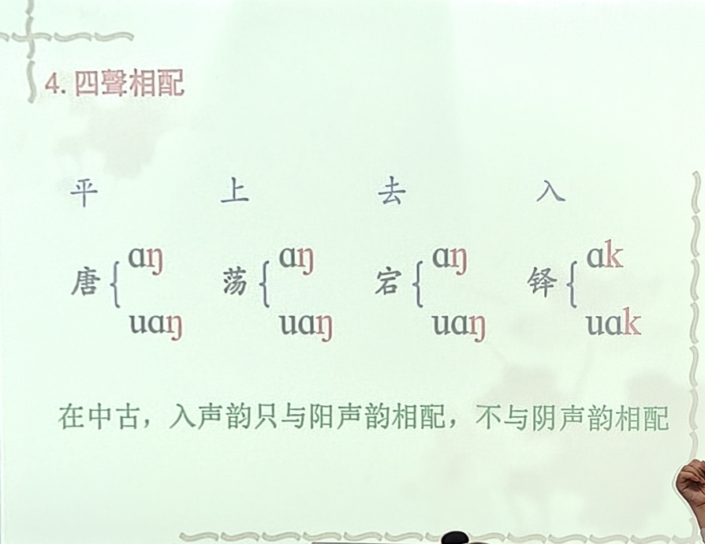
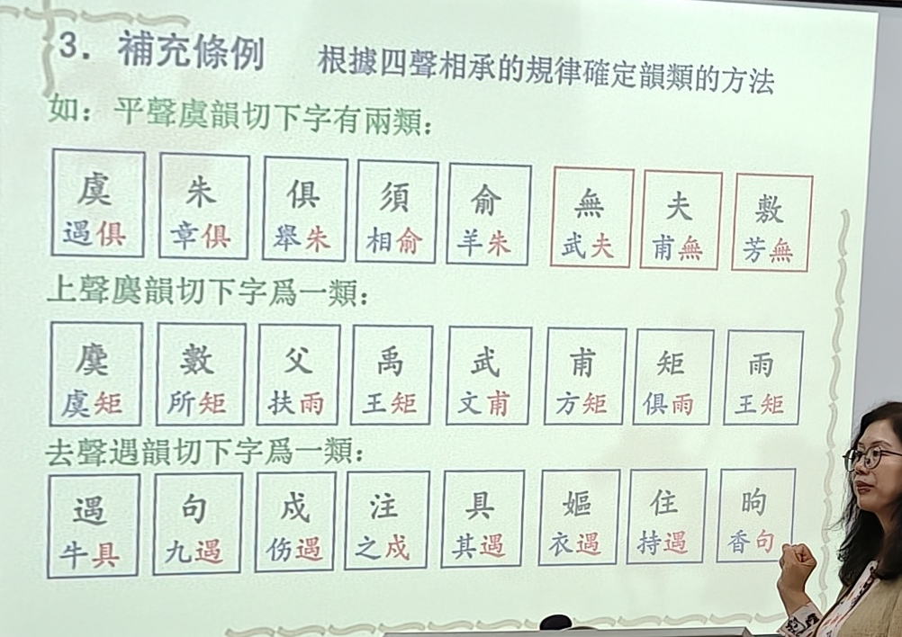

# 《音韵学》课程笔记 
## 第一章 基础知识 
## 第二章 中古音韵系统 
### 第一节 《广韵》的性质和体例 
#### 一、《广韵》以前的韵书 
#### 二、《广韵》的产生和性质 
#### 三、《广韵》的体例 

### 第二节 系联《广韵》反切 
⚪利用反切的原因：  
①《广韵》没有直接显示声母韵母系统；  
②宋人三十六字母代表北宋时期的声母，与《广韵》声母不同；  
③《广韵》有3875个小韵，实际上有3873个反切注音，成为我们研究《广韵》声母韵母的资料。
⚪利用反切的原理：
①对反切上下字进行分析、归纳；  
②不能根据今音来判断反切上下字的类别；  
③清代陈澧《切韵考》，发明了**反切系联法**。  
系联法的基本依据就是反切的原理，即反切上字与被切字的聱母必然相同，反切下字与被切字的韵母及声调必然相同。  
其系联的条例共有三项：基本条例、分析条例、补充条例。  

#### 一、关于反切上字的系联 
1.基本条例  切语上字同用者、互用者、递用者，声必同类也；  
2.分析条例：在同一韵中，两切语下字同类者，则上字必不同类；  
3.补充条例：“然有实同类而不能系联者”，则利用又音。

#### 二、关于反切下字的系联 
基本条例、分析条例与上字相同；  
补充条例：利用四声相承的规律。  
